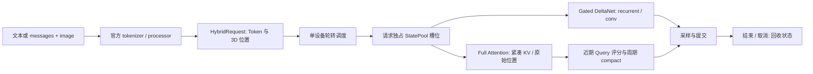

# Qwen3.5 混合架构与动态 KV 压缩改造

本次改造依据用户提供的《从 nano-vLLM 到 Qwen3.5：混合架构推理引擎图解教程》和项目描述实现。压缩包是设计参考，其中教学性能数字未作为项目实测。实现与验证时间：2026-11-04。

新增可运行的 **dense Qwen3.5、单设备 eager 参考 kernel 后端**。它复用 Transformers 的官方模型组件，调度、请求状态、KV 压缩及投机事务由本项目负责，前向没有调用 `Transformers.generate`。原 Qwen3 保留原来的 NCCL、FlashAttention、分页 KV 与 CUDA Graph 路径。

## 交付范围与边界

| 文档中的能力 | 本次实现 | 验证或限制 |
|---|---|---|
| Gated DeltaNet / Full Attention 分流 | 依照 checkpoint 的 `layer_types` 执行官方层 | 小模型 FP32 对齐；真实 0.8B BF16 预填充和三步 teacher forcing logits 完全一致 |
| 请求状态槽位 | `StatePool` 按 request ID 分配；结束/取消释放，复用时重新创建 | 随机槽位复用、真实请求交错、抢占重算和取消测试 |
| 分块预填充 | 首块使用 chunkwise GDN，后续使用 recurrent 单步续接 | 修正固定版本参考层多 Token 续接会重新初始化状态的问题；更慢，BF16 存在舍入误差 |
| 逻辑与物理长度分离 | `logical_length`、逐层 `positions` 和 K/V 的真实长度独立 | 压缩后位置不重新编号，GDN 与卷积状态逐位不变 |
| messages + image | 官方 processor、视觉特征注入、Interleaved MRoPE | 红色图片 + 压缩 + 连续解码通过；视觉 Token 强制保留，预算不足报错 |
| FP8 checkpoint | 显式 block scale 反量化后以 BF16 常驻；逐参数流式加载 | 合成 FP8 checkpoint、缺失/形状契约与两种 TP 分片数值测试；未测试真实 FP8 checkpoint，不是 FP8 GEMM |
| MTP 原型 | 加载真实 `mtp.*` 权重；`generate_mtp` 草稿、贪心验证、快照恢复、接受前缀回放 | 真实检查点生成对齐、压缩组合和强制拒绝测试；验证为串行，保留全量 hidden history 并逐轮重建 draft history，不宣称加速 |
| 周期 KV 压缩 | 近期 Query 对现存历史 KV 的因果注意力评分、max pooling、top-k 历史 + 最近窗口 | 各 Full Attention 层独立选择，同层各头使用统一位置；属于 SnapKV 思路的周期扩展 |
| 实际缓存占用降低 | `index_select` 紧凑复制，全部层搬运成功后发布映射 | 新张量拥有紧凑存储，旧引用释放后 allocator 可复用；不采用原生分页 block 池 |
| 基准与质量测试 | TTFT、TPOT、ITL、解码/系统吞吐、KV/状态字节和 CUDA 内存 | 性能消融、官方 LongBench v1 子集、Needle；原始记录随仓库提交 |
| 混合路径多卡 TP | 尚未实现 | `tensor_parallel_size != 1` 明确报错；FP8 分片工具测试不等于端到端 TP |
| 混合路径 CUDA Graph | 尚未实现 | `enforce_eager=False` 明确报错；不声称验证了 Graph 与动态状态组合 |
| 混合路径共享前缀 / 分页压缩 | 尚未实现 | 每请求独占动态 KV，避免共享前缀被有损修改；不能以此宣称原生分页容量提升 |
| MoE、视频、随机投机采样 | 不在本次支持范围 | 本次仅验证 dense、文本和静态图像，MTP 仅贪心 |

因此，本次交付是有实测证据的混合推理与压缩原型，还不是文档所描述的所有高级组合的完整高性能实现。

## 状态与执行路径



`len(tokens)` 表示已经接收及输出的 Token 数，`cache.logical_length` 表示模型真正消费的数量。末次采样结果通常尚未写入状态。压缩只缩短各 Attention 层的物理 K/V，GDN 仍表达完整的已消费历史，原始 RoPE 坐标保持不变。

投机事务复制 KV、位置、recurrent、conv 和 Query 观测缓冲。验证期间冻结压缩，拒绝后恢复快照并回放接受前缀；发生异常也恢复。真实模型测试覆盖实际 MTP 候选和人为构造的拒绝。压缩后的 target 是有损近似，MTP 的正确性只相对于固定缓存状态与压缩提交计划成立。

当前调度按请求轮转，在一个 GPU 上逐请求执行；没有将多个请求融合为一个 CUDA batch，也没有在线服务接口。等待请求的 prompt embedding 已准备并保留，`max_num_seqs` 仅限制活跃状态槽位，不是总显存硬限额。重算抢占会重新构造近似 KV，不能替代压缩状态的精确快照恢复。

## 安装与运行

建议使用独立的 Python 3.12 环境。Windows 上的 PyTorch fallback 已实测；Linux 可额外安装 GDN kernel，但需要重新进行数值与性能验证，不能套用本报告。

```bash
pip install torch==2.10.0 torchvision==0.25.0 --index-url https://download.pytorch.org/whl/cu128
pip install -e ".[test,eval]"
```

原 Qwen3 的原生后端还需要 Linux 和 `pip install -e ".[cuda]"`。完整的 Windows 实测依赖版本见 `requirements/hybrid-win-cu128.txt`。

锁定本次使用的真实检查点：

```python
from huggingface_hub import snapshot_download

snapshot_download(
    "Qwen/Qwen3.5-0.8B",
    revision="2fc06364715b967f1860aea9cf38778875588b17",
    local_dir=".work/models/Qwen3.5-0.8B",
)
```

文本、压缩与贪心生成：

```python
from nanovllm import LLM, SamplingParams
from nanovllm.engine.hybrid_cache import CompressionConfig

llm = LLM(
    ".work/models/Qwen3.5-0.8B",
    enforce_eager=True,
    compression=CompressionConfig(budget=512, window=32, interval=32),
)
output = llm.generate(
    ["The capital of France is"],
    SamplingParams(temperature=0, max_tokens=32),
)[0]
print(output["text"], output["metrics"])
llm.exit()  # 可重复调用；退出时回收所有未完成请求状态
```

图文输入：

```python
from PIL import Image

prompt = {"messages": [{"role": "user", "content": [
    {"type": "image", "image": Image.open("example.png")},
    {"type": "text", "text": "Describe this image briefly."},
]}]}
result = llm.generate([prompt], SamplingParams(temperature=0, max_tokens=64))
```

保持引擎打开时，可单独调用实验性 MTP：

```python
result = llm.generate_mtp(
    "The capital of France is",
    SamplingParams(temperature=0, max_tokens=32),
    depth=3,
)
print(result["mtp"])  # 草稿数、接受数、输出 burst；不把接受率当作加速比
```

MTP 的同轮多个输出在验证完成后同时可见，`itl_ms` 会出现零间隔。应同时检查 `bursts` 和端到端时间；不能把普通逐 Token TPOT 解释成每个 Token 的计算延迟。该原型使用真实草稿权重，但串行验证无法消除 target 计算量。

## 复现验证和报告

```bash
python -m pytest -q tests
python -m benchmarks.check_compatibility --model .work/models/Qwen3.5-0.8B
python -m benchmarks.evaluate_hybrid --model .work/models/Qwen3.5-0.8B --output reports/new-run --lengths 1024 4096 16384 --quality-limit 8192 --repeats 3 --samples 4
```

数据和官方指标代码下载到 `.work`，不随仓库提交。LongBench 数据 revision 为 `5e628be450b7e67fb7ae6e201bd6d8f7056f7672`，prompt 与指标代码 revision 为 `2e00731f8d0bff23dc4325161044d0ed8af94c1e`。默认三项任务各取前四条；以官方模板形成 prompt、按 Token 从中间截断，再应用关闭 thinking 的 Qwen chat template。这是明确变更了长度和聊天包装的小样本协议，不等同完整官方排行榜。

性能每组预热后重复三次并交替顺序。每次输出前完成 GPU 同步，保留每次真实发出 Token 的时间。报告分别记录存活 KV、GDN/conv/观测缓冲、CUDA allocated 峰值和 reserved 峰值；压缩后的 KV 变小不表示预填充峰值同比下降。源文件 SHA256 和本地模型 config 哈希记录于环境文件，避免把测试前的 Git HEAD 当作最终被测代码。

当前 Windows/PyTorch 的原生 GQA 在超长预填充时可能选择二次方显存的 math 后端。超过 8192 个新输入 Token 时，适配器显式展开 KV 头，允许 SDPA 使用内存高效的 kernel；较短输入复用官方 GQA 分派。二者的数学表达相同，但 BF16 不保证逐位一致。测试分别覆盖参考短输入的数值对齐与长输入的后端选择；报告记录实际峰值，未把 WDDM 换页运行当作有效性能样本。

实测文件：

- [实测结论、质量损失与验证边界](../reports/qwen35_rtx4090/ANALYSIS_ZH.md)
- [性能与质量报告](../reports/qwen35_rtx4090/PERFORMANCE_REPORT_ZH.md)
- [逐案例原始日志](../reports/qwen35_rtx4090/results.jsonl)
- [真实模型兼容性证据](../reports/qwen35_rtx4090/compatibility.json)
- [环境与被测源码哈希](../reports/qwen35_rtx4090/environment.json)

首轮探索发现并修复了 Windows 默认 GBK 读 JSON、tokenizer 默认返回字典，以及 SDPA GQA kernel 分派对齐问题。最终报告重新运行，未混入修改前的性能记录。

## 主要文件

| 文件 | 职责 |
|---|---|
| `nanovllm/llm.py` | 根据 model_type 延迟导入后端；未知架构报错 |
| `nanovllm/models/qwen3_5.py` | 官方组件适配、紧凑 KV Attention、视觉注入和原始位置 |
| `nanovllm/engine/hybrid_engine.py` | 请求调度、生命周期、文本/图文/MTP 入口、逐请求指标 |
| `nanovllm/engine/hybrid_cache.py` | 逻辑/物理状态、Query 观测、原子 compact、槽位与快照 |
| `nanovllm/engine/speculation.py` | 贪心验证、预算/EOS、拒绝与异常恢复 |
| `nanovllm/models/qwen3_5_mtp.py` | 真正 MTP 权重、shifted hidden/embedding 输入和草稿 |
| `nanovllm/utils/fp8.py` | 显式 FP8 scale 契约、对齐分片及严格流式加载 |

## 一手参考

- [固定 Transformers 5.3.0 Qwen3.5 实现](https://github.com/huggingface/transformers/blob/v5.3.0/src/transformers/models/qwen3_5/modeling_qwen3_5.py)：GDN、视觉、MRoPE 与层/缓存接口；组件使用 Transformers 的 Apache-2.0 实现。
- [官方 0.8B 模型配置](https://huggingface.co/Qwen/Qwen3.5-0.8B/blob/2fc06364715b967f1860aea9cf38778875588b17/config.json)：18 个 GDN 层、6 个 Full Attention 层与实际维度。
- [SnapKV 论文](https://arxiv.org/abs/2404.14469)：观察窗口、注意力聚合和 pooling；本实现是共享头选择、逐层周期压缩的工程变体。
- [vLLM Qwen3.5 MTP](https://github.com/vllm-project/vllm/blob/main/vllm/model_executor/models/qwen3_5_mtp.py)：MTP 结构与 checkpoint 命名参考；未引入 vLLM 运行时。
- [LongBench 固定版本](https://github.com/THUDM/LongBench/tree/2e00731f8d0bff23dc4325161044d0ed8af94c1e/LongBench)：官方模板和各任务指标，不将 v1 与 v2 混合计分。
